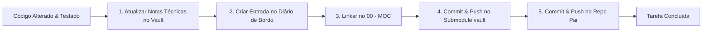

# 🤖 Diretrizes do Agente & Protocolo de Memória (Obsidian Vault) — TW Network

> Este arquivo é a diretriz mestre de trabalho para qualquer agente ou engenheiro de IA atuando no repositório **TW Network**. As instruções abaixo são leis invioláveis de operação.

---

## 🛑 LEI ZERO: Consulte Sempre o Vault Primeiro (Proibido Varrer Arquivos às Cegas)

**NUNCA saia inspecionando ou varrendo dezenas de arquivos do repositório como um maluco.**
Toda a inteligência, arquitetura, regras de negócio, game loop e histórico de decisões do ecossistema já estão documentados de forma estruturada no **Super-Vault Unificado** na pasta **`vault/`**.

### Protocolo Obrigatório de Inicialização de Toda Tarefa:
1. **Primeiro Passo Absoluto:** Abra e consulte o índice mestre em [`vault/00 - MOC (Map of Content).md`](file:///c:/Users/DaviPsss/OneDrive/Documentos/GitHub/SIte%20Server%20Minecraft/twnetworksite/vault/00%20-%20MOC%20(Map%20of%20Content).md).
2. **Segundo Passo:** Leia as notas técnicas específicas do pilar correspondente antes de tocar no código:
   - `01 - Web e Loja`: [[Neon PostgreSQL]], [[Seguranca e Hardening]], [[Autenticacao e Contas]], [[Mercado Pago SDK]], [[Render Web Service]].
   - `02 - Plugins Java`: [[01-ARCHITECTURE-AND-CORE-RULES]], [[02-CORE-MODULE]], [[04-RANKS-MODULE]], [[11-FEATURE-COOKBOOK]].
   - `03 - Servidor e Game Loop`: [[rag_consolidado]], [[tabela_precos]], [[tw_ranks]], [[mundo_minas]], [[comandos_jogadores]].
3. **Respeite Decisões Consolidadas:** Não altere padrões já decididos (ex: uso do pooler do Neon, porta 3000, `--include=dev` no build do Render, política COOP `same-origin-allow-popups`) sem justificativa técnica e alinhamento explícito.

---

## ⚡ LEI DA MEMÓRIA: Atualização Automática Obrigatória a Cada Commit

**NENHUMA tarefa, commit ou deploy está finalizado sem que o Vault seja alimentado e comitado.**
A cada correção de bug, nova funcionalidade, alteração de banco de dados ou deploy, o agente **DEVE OBRIGATORIAMENTE** seguir este ritual de fechamento:



### Checklist Obrigatório Pré-Commit:
1. **Atualizar a Nota Técnica:**
   - Alterou banco de dados? ➔ Atualize `vault/01 - Web e Loja/🗄️ Banco de Dados/Tabela X.md`.
   - Alterou segurança/backend? ➔ Atualize `[[Seguranca e Hardening]]` ou `[[Autenticacao e Contas]]`.
   - Alterou loja/economia? ➔ Atualize `[[tabela_precos]]` ou notas do `03 - Servidor e Game Loop`.
2. **Registrar no Diário de Bordo:**
   - Crie ou complemente o registro diário em `vault/04 - Diario de Bordo/YYYY-MM-DD - Titulo da Tarefa.md` com resumo das entregas e referências `[[wikilinks]]`.
3. **Preservar o Grafo do Obsidian:**
   - Toda nova nota DEVE ter links bidirecionais e DEVE constar no `vault/00 - MOC (Map of Content).md` para evitar nós órfãos (`Ctrl + G`).
4. **Comitar e Enviar o Submódulo Primeiro:**
   ```powershell
   git -C vault add .
   git -C vault commit -m "docs(vault): <resumo das atualizações>"
   git -C vault push origin main
   ```
5. **Comitar o Repositório Pai com o Ponteiro do Submódulo:**
   ```powershell
   git add src/ server.ts vault
   git commit -m "tipo(escopo): <mensagem do commit>"
   git push origin main
   ```

---

## 🛡️ Diretrizes Críticas de Segurança e Ambiente

* **NUNCA commitar `.env`:** O arquivo `.env` deve sempre permanecer ignorado no `.gitignore`. Utilize apenas `.env.example.production` para expor chaves públicas ou modelos.
* **Proibição Estrita de Contas Demo:** É proibido manter contas de teste mockadas com senhas fracas (como `'123'`) no backend, no banco de dados ou no `localStorage`. Em produção, toda autenticação é 100% real (PostgreSQL Neon + Google OAuth).
* **Fail-Fast de Produção:** Mantenha a checagem no `server.ts` que bloqueia inicializações com chaves dev ou sem `JWT_SECRET` em modo de produção.
* **Build do Render:** O comando de compilação deve ser sempre `npm install --include=dev && npm run build` para garantir que o Vite seja instalado mesmo com `NODE_ENV=production`.
* **Banco Neon:** A conexão em produção deve sempre usar SSL (`ssl: { rejectUnauthorized: false }`) e respeitar o endpoint `-pooler`.
* **Compatibilidade de Popups Google (COOP):** O Helmet deve manter `crossOriginOpenerPolicy: { policy: 'same-origin-allow-popups' }` e `referrerPolicy: { policy: 'strict-origin-when-cross-origin' }` para evitar travamento em tela branca no login com Google.

---

## 🎮 Identidade Visual e Minecraft

* Todos os ícones do jogo devem usar o componente `<McIcon name="..." />` consumindo os arquivos locais de `public/mc-icons/` com a classe `pixelated`. Nunca utilize CDNs instáveis de terceiros para texturas do Minecraft.
