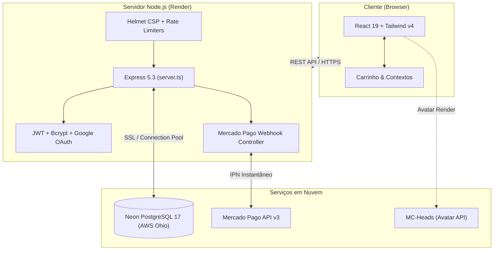

<div align="center">

# 🌐 TW Network — Portal Oficial & Loja Integrada

**A plataforma web oficial e central de e-commerce da rede de servidores TW Network.**  
*Servidor focado em RankUP Inovador, Economia Balanceada e Minigames com Premiações Reais.*

[](https://react.dev/)
[](https://vitejs.dev/)
[](https://expressjs.com/)
[](https://tailwindcss.com/)
[](https://neon.tech/)
[](https://www.mercadopago.com.br/developers)
[](https://render.com/)

<br />

🎮 **IP do Servidor:** `twnetwork.com.br` &nbsp;|&nbsp; 🛒 **Loja Web:** [twnetwork.onrender.com](https://twnetwork.onrender.com) &nbsp;|&nbsp; 💬 **Discord:** [Comunidade TW](https://discord.gg/)

</div>

---

## 📑 Sumário

- [📖 Sobre o Projeto](#-sobre-o-projeto)
- [✨ Principais Funcionalidades](#-principais-funcionalidades)
- [🏛️ Arquitetura do Sistema](#️-arquitetura-do-sistema)
- [🛠️ Stack Tecnológica](#️-stack-tecnológica)
- [📂 Estrutura de Pastas](#-estrutura-de-pastas)
- [🚀 Começando Localmente](#-começando-localmente)
  - [Pré-requisitos](#pré-requisitos)
  - [Passo a Passo](#passo-a-passo)
  - [Variáveis de Ambiente](#variáveis-de-ambiente)
- [☁️ Deploy & Produção](#️-deploy--produção)
- [🧠 Segundo Cérebro (Obsidian Vault)](#-segundo-cérebro-obsidian-vault)
- [🛡️ Segurança e Hardening (OWASP 2025)](#️-segurança-e-hardening-owasp-2025)
- [👥 Equipe e Créditos](#-equipe-e-créditos)

---

## 📖 Sobre o Projeto

O **TW Network Site** é uma aplicação **Full-Stack moderna** que une a identidade visual clássica do Minecraft a uma arquitetura web de alta fidelidade e performance.

O projeto atua tanto como vitrine para a comunidade quanto como plataforma de monetização e gestão de jogadores:
- **RankUP Especializado:** Ecossistema de mineração, evolução de patentes, economia dinâmica e eventos de temporada.
- **Minigames Competitivos:** Torneios programados com premiações reais e rankings competitivos.
- **Ecossistema Integrado:** Sincronização entre as contas da loja web e as contas in-game via UUID/Nick com ativação automatizada de VIPs e Cash.

---

## ✨ Principais Funcionalidades

### 🛒 E-Commerce & Checkout Automatizado
- **Catálogo Dinâmico:** Planos VIP (VIP, VIP+, MVP, MVP+ e TW), pacotes de Cash e itens colecionáveis.
- **Carrinho com Estado Reativo:** Gerenciado via Context API (`CartContext`) com cálculo de frete zero e persistência em `localStorage`.
- **Sistema de Cupons:** Validação em tempo real no banco PostgreSQL com suporte a descontos percentuais e proteção anti-bruteforce.
- **Gateway Mercado Pago (v3):** Geração dinâmica de pagamentos via **PIX com QR Code dinâmico**, linha digitável Copia e Cola e conciliação instantânea via **Webhooks IPN**.

### 🔐 Autenticação Híbrida & Gestão de Identidade
- **Login Local:** Autenticação por e-mail e senha com hashing seguro via `bcryptjs` e emissão de `jsonwebtoken` (JWT).
- **Google OAuth 2.0:** Suporte nativo ao Google Identity Services (GSI) via `google-auth-library`.
- **Vinculação de Nick Minecraft:** Busca da cabeça do jogador em tempo real através do serviço `mc-heads.net`.

### 🎮 Player Hub & Gamificação
- **Painel do Jogador:** Acesso a perfil, histórico de pedidos, compras ativas e saldo de Cash.
- **Recompensas Diárias:** Sistema de coleta de recompensas para resgate in-game.
- **Status do Servidor em Tempo Real:** Ping automatizado para monitorar se o servidor de Minecraft está online e exibir a contagem de jogadores.

### 🎨 Design System Minecraft Nativo
- **Ícones Oficiais Pixelados:** Componente `<McIcon />` consumindo 42 texturas locais de alta resolução em `public/mc-icons/` com renderização nítida (`image-rendering: pixelated`).
- **Animações Fluidas:** Transições de abas, modais e banners impulsionados por **Framer Motion**.
- **Tema Festivo & Sonoplastia:** Efeitos de neve com `Snowfall` e áudio reativo via `SoundContext`.

---

## 🏛️ Arquitetura do Sistema



---

## 🛠️ Stack Tecnológica

| Camada | Tecnologia | Versão | Descrição |
| :--- | :--- | :--- | :--- |
| **Frontend** | [React](https://react.dev/) | `19.2` | Interface do usuário reativa e declarativa |
| **Build Tool** | [Vite](https://vitejs.dev/) | `8.3` | Bundler e ambiente de desenvolvimento ultrarrápido |
| **Estilização** | [Tailwind CSS](https://tailwindcss.com/) | `v4.3` | Engine utilitária de CSS de última geração |
| **Animações** | [Framer Motion](https://www.framer.com/motion/) | `14.1` | Animações e micro-interações de alta performance |
| **Backend** | [Express](https://expressjs.com/) | `5.3` | API REST robusta servida via TypeScript runtime ([TSX](https://github.com/privatenumber/tsx)) |
| **Banco de Dados** | [Neon PostgreSQL](https://neon.tech/) | `17` | Banco relacional Serverless com pooling e SSL nativo |
| **Pagamentos** | [Mercado Pago SDK](https://github.com/mercadopago/sdk-nodejs) | `3.6` | Integração oficial de pagamentos PIX e checkout transparente |
| **Segurança** | [Helmet](https://helmetjs.github.io/) / [Rate-Limit](https://github.com/express-rate-limit/express-rate-limit) | `8.3` / `8.7` | Proteção de headers HTTP (CSP) e mitigação de brute-force |
| **Ícones & Notificações** | [Lucide React](https://lucide.dev/) / [Sonner](https://sonner.emilkowal.ski/) | `1.55` / `2.0` | Ícones SVG modernos e sistema de toasts sonoros |
| **Qualidade de Código** | [Oxlint](https://oxc.rs/) | `1.81` | Linter Rust ultra-rápido para manter padrões de código |

---

## 📂 Estrutura de Pastas

```text
twnetworksite/
├── public/                     # Arquivos estáticos servidos diretamente
│   └── mc-icons/               # 42 texturas e itens originais do Minecraft
├── src/                        # Código-fonte do Frontend (React)
│   ├── assets/                 # Imagens, vetores e logos da TW Network
│   ├── components/             # Componentes modulares (Navbar, Hero, PlayerHub, etc.)
│   ├── context/                # Contextos globais (Auth, Cart, Order, Theme, Sound)
│   ├── data/                   # Catálogo de produtos, VIPs, planos e comandos
│   ├── hooks/                  # Custom hooks (useServerPing, etc.)
│   ├── pages/                  # Rotas da aplicação (Home, Loja, Carrinho, Checkout, etc.)
│   ├── App.jsx                 # Configuração de rotas e providers
│   └── main.jsx                # Ponto de entrada do React
├── vault/                      # 🧠 Obsidian Vault (Segundo Cérebro & Documentação Técnica)
│   ├── 00 - MOC (Map of Content).md
│   ├── 🏗️ Arquitetura/          # Decisões de stack, segurança e infra
│   ├── 🗄️ Banco de Dados/       # DDLs das tabelas usuarios, pedidos, cupons
│   └── 📅 Diário de Bordo/     # Histórico de alterações e deploys diários
├── db.ts                       # Pooler de conexão PostgreSQL com Neon
├── server.ts                   # Servidor Express, endpoints REST e Webhooks
├── render.yaml                 # Blueprint de Infraestrutura como Código (IaC) para o Render
├── .env.example.production     # Template documentado de variáveis de ambiente
└── package.json                # Dependências e scripts do projeto
```

---

## 🚀 Começando Localmente

### Pré-requisitos
- **[Node.js](https://nodejs.org/)** (v20 LTS ou superior recomendado).
- **[npm](https://www.npmjs.com/)** ou gerenciador de pacotes equivalente.
- Uma instância **PostgreSQL** local ou string de conexão do **[Neon.tech](https://neon.tech/)**.

### Passo a Passo

1. **Clone o repositório:**
   ```bash
   git clone https://github.com/seu-usuario/twnetworksite.git
   cd twnetworksite
   ```

2. **Instale as dependências:**
   ```bash
   npm install
   ```

3. **Configure as Variáveis de Ambiente:**
   Copie o arquivo de exemplo para criar o seu `.env` local:
   ```bash
   cp .env.example.production .env
   ```
   > Edite o arquivo `.env` inserindo sua string `DATABASE_URL`, o token do Mercado Pago e seu `JWT_SECRET`.

4. **Inicie o servidor de desenvolvimento:**
   ```bash
   npm run dev
   ```
   *O backend Express + frontend Vite inicializarão juntos através do `tsx` no endereço [http://localhost:3000](http://localhost:3000).*

5. **Outros comandos úteis:**
   ```bash
   npm run lint        # Executa a checagem rápida de linter com Oxlint
   npm run build       # Compila a aplicação para o diretório dist/
   npm start           # Inicia o servidor em modo de produção
   ```

---

## 🔐 Variáveis de Ambiente

Principais variáveis configuradas em `.env`:

| Variável | Obrigatória | Descrição |
| :--- | :---: | :--- |
| `NODE_ENV` | Sim | `development` ou `production`. |
| `PORT` | Não | Porta do servidor HTTP (padrão: `3000`). |
| `DATABASE_URL` | Sim | String de conexão PostgreSQL (com SSL ativado no Neon). |
| `DB_SSL` | Não | `true` para conexões em nuvem/Neon; `false` para PostgreSQL local. |
| `JWT_SECRET` | Sim | Chave de alta entropia para assinatura dos tokens de autenticação. |
| `ALLOWED_ORIGINS` | Não | Domínios autorizados para CORS separados por vírgula. |
| `MERCADOPAGO_ACCESS_TOKEN` | Sim | Access Token de Produção ou Teste gerado no Mercado Pago. |
| `GOOGLE_CLIENT_ID` | Não | Client ID do Google Cloud Console para ativação do Google Login. |

---

## ☁️ Deploy & Produção

O projeto está pronto para deploy contínuo em 1-clique no **[Render](https://render.com/)** utilizando o arquivo de Blueprint [`render.yaml`](render.yaml):

```yaml
buildCommand: npm install --include=dev && npm run build
startCommand: npm start
healthCheckPath: /api/health
```

> [!IMPORTANT]
> A flag `--include=dev` é obrigatória no build do Render para garantir que o Vite e as ferramentas de build sejam devidamente instaladas quando o ambiente estiver operando com `NODE_ENV=production`.

---

## 🧠 Segundo Cérebro (Obsidian Vault)

Este repositório possui uma base de conhecimento viva e bidirecional na pasta **`vault/`**.  
Se você utiliza o **[Obsidian](https://obsidian.md/)**, basta abrir a pasta do projeto como um cofre (*Open folder as vault*):

- **`00 - MOC (Map of Content).md`**: Mapa mental com links para todos os tópicos do projeto.
- **Decisões Registradas**: Esquema de tabelas, fluxos de pagamento, regras de negócios e políticas de segurança.
- **Diário de Bordo**: Histórico cronológico das implementações.

---

## 🛡️ Segurança e Hardening (OWASP 2025)

- **Fail-Fast Boot:** O servidor cancela a inicialização caso segredos críticos de produção (como `JWT_SECRET`) estejam ausentes ou utilizando valores padrão de teste.
- **Helmet CSP:** Protege os usuários contra ataques XSS e injeção de scripts não autorizados.
- **Rate Limiting:** Rotas sensíveis (como tentativas de login e aplicação de cupons) são protegidas contra ataques de força bruta.
- **Conexão Criptografada:** Comunicação com o cluster Neon via TLS/SSL obrigatório com isolamento de credenciais.

---

## 👥 Equipe e Créditos

<div align="center">

Desenvolvido com dedicação por apaixonados pelo universo Minecraft.

**TW Studios**  
*Idealização, Game Design & Engenharia de Software*

---

*Minecraft é uma marca registrada da Mojang Synergies AB. Este projeto não possui afiliação direta com a Mojang ou Microsoft.*

</div>
