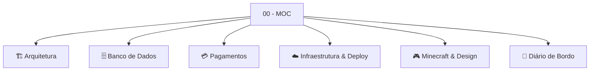

---
tags:
  - moc
  - index
  - twnetwork
aliases:
  - Índice
  - Home
  - Map of Content
created: 2026-11-05
---

# 🗺️ 00 - MOC (Map of Content) — TW Network

> Bem-vindo ao **Segundo Cérebro (Obsidian Vault)** da rede **TW Network** (Servidor de Minecraft RankUP & Loja Full-Stack).
> Este cofre centraliza todas as decisões arquiteturais, esquemas de banco de dados, fluxos de pagamento, regras de segurança e diários de bordo do projeto.

---

## 🧭 Navegação Rápida (Clusters de Conhecimento)

---

### 1. 🏗️ Arquitetura de Software
* [[Tech Stack]] — Tecnologias utilizadas (React 19, Vite 8, Express 5, Tailwind CSS v4, PostgreSQL 17).
* [[Seguranca e Hardening]] — Diretrizes OWASP 2025, Helmet CSP, proxy reverso confiável e validações.
* [[Autenticacao e Contas]] — Sessões com JWT, hashing Bcrypt, Google OAuth 2.0 e vinculação de Nick.

### 2. 🗄️ Banco de Dados (PostgreSQL)
* [[Neon PostgreSQL]] — Cluster serverless na nuvem (AWS Ohio), pooling e SSL.
* [[Tabela Usuarios]] — Esquema DDL, permissões, patentes VIP, saldo de cash e contas staff.
* [[Tabela Pedidos]] — Pedidos com foreign keys, itens em JSONB e status de entrega.
* [[Tabela Cupons]] — Sistema de cupons com desconto percentual e proteção anti-bruteforce.

### 3. 💳 Pagamentos & Monetização
* [[Mercado Pago SDK]] — Integração com o SDK oficial da API v3 do Mercado Pago.
* [[Fluxo Pix]] — Geração dinâmica de QR Code, chave Copia-e-Cola e confirmação via Webhook.

### 4. ☁️ Infraestrutura e Nuvem
* [[Render Web Service]] — Hospedagem oficial da aplicação, healthcheck e URLs públicas.
* [[Render Blueprint render.yaml]] — Infraestrutura como Código (IaC) para deploy em 1 clique.
* [[Variaveis de Ambiente]] — Catálogo e segredos de produção (`DATABASE_URL`, `JWT_SECRET`, etc.).
* [[Configs de Servidor Nginx e Docker]] — Modelos de PM2, Nginx VirtualHost com cache de 1 ano e Dockerfile.

### 5. 🎮 Minecraft & Identidade Visual
* [[Texturas e Icones Minecraft]] — 42 ícones locais em PNG de alta fidelidade sem delay externo.
* [[Design System e Componentes]] — Paleta de cores, animações Framer Motion e toasts Sonner.

### 6. 📅 Diário de Bordo (Changelog de Decisões)
* [[2026-11-03 - Redesign Frontend e Seguranca]] — Refatoração de componentes, limpeza de dead-code e hardening.
* [[2026-11-05 - Setup Neon e Deploy no Render]] — Criação do cluster Neon, execução do DDL inicial e Go-Live público.

---

> [!TIP] Dica de Navegação no Obsidian
> Pressione **`Ctrl + G`** no Obsidian para abrir a visualização em grafo (**Graph View**) e explorar as conexões visuais entre as notas!
