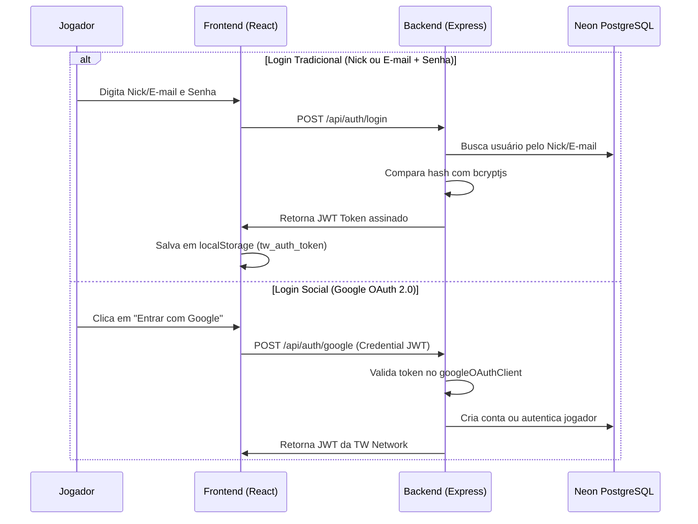

---
tags:
  - autenticacao
  - jwt
  - oauth
  - contas
aliases:
  - Auth
  - Login
created: 2026-11-05
---

# 🔑 Autenticação e Contas — TW Network

> Fluxos de cadastro, login, sessões seguras e vinculação de Nickname do Minecraft para jogadores da rede TW Network.

Voltar para o [[00 - MOC (Map of Content)]] | Ver [[Tabela Usuarios]].

---

## 📋 Métodos de Entrada do Jogador

---

## 🎮 Validação e Vinculação de Nickname

O sistema garante que os benefícios comprados na loja sejam entregues para a pessoa certa no servidor:

1. **Formato do Nickname:**
   - Entre 3 e 16 caracteres.
   - Apenas letras, números e underscore (`^[a-zA-Z0-9_]+$`).
   - Verificado no backend através da função `validarFormatoNick()`.

2. **Vinculação Obrigatória:**
   - Usuários que entram pelo Google entram inicialmente com `nick_vinculado = false`.
   - Um modal interativo (`VincularNickModal.jsx`) solicita ao jogador que informe o seu Nick exato do Minecraft antes de finalizar qualquer compra na loja.
   - Endpoint: `POST /api/auth/vincular-nick`.

---

## 🔗 Relações & Conexões
* [[Tabela Usuarios]] — Onde os dados de sessão e senhas ficam persistidos.
* [[Seguranca e Hardening]] — Proteção com Rate Limit de 20 tentativas para evitar ataques de força bruta.
* [[Fluxo Pix]] — O pedido fica associado ao Nick vinculado para entrega dos itens.
