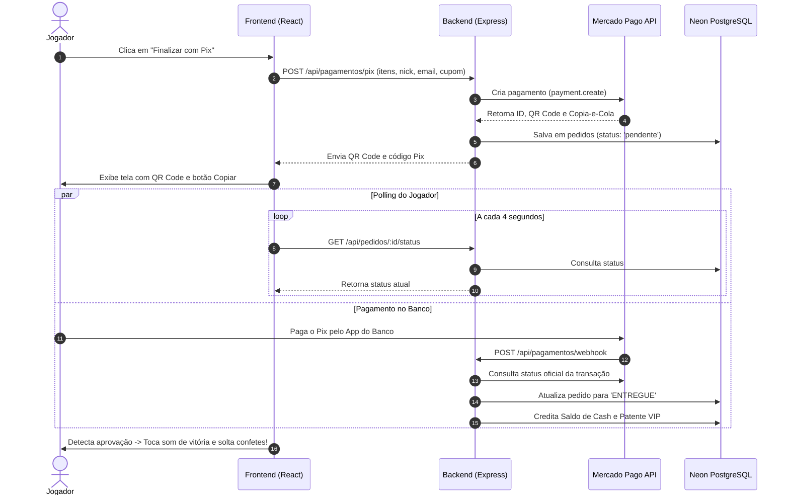

---
tags:
  - pagamentos
  - pix
  - mercadopago
aliases:
  - Pix
created: 2026-11-05
---

# ⚡ Fluxo Pix — TW Network

> Arquitetura do fluxo de pagamento instantâneo via Pix com confirmação em tempo real e entrega imediata.

Voltar para o [[00 - MOC (Map of Content)]] | Ver [[Mercado Pago SDK]].

---

## 🔄 Fluxograma do Ciclo de Compra

---

## 📱 Componentes da Interface no Frontend
* **`PixModal.jsx` / `ConclusaoPage.jsx`**: Exibem o tempo restante de expiração do Pix (geralmente 30 minutos), botão de cópia com feedback visual via `sonner`, e animação de confetes via `canvas-confetti` assim que a transação é confirmada.

---

## 🔗 Relações & Conexões
* [[Tabela Pedidos]] — Onde o status da transação transita de `pendente` para `ENTREGUE`.
* [[Tabela Usuarios]] — Jogador que recebe o saldo de Cash e a patente VIP.
* [[Mercado Pago SDK]] — Provedor oficial do gateway Pix.
